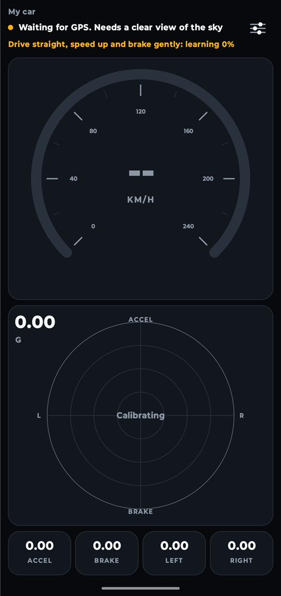
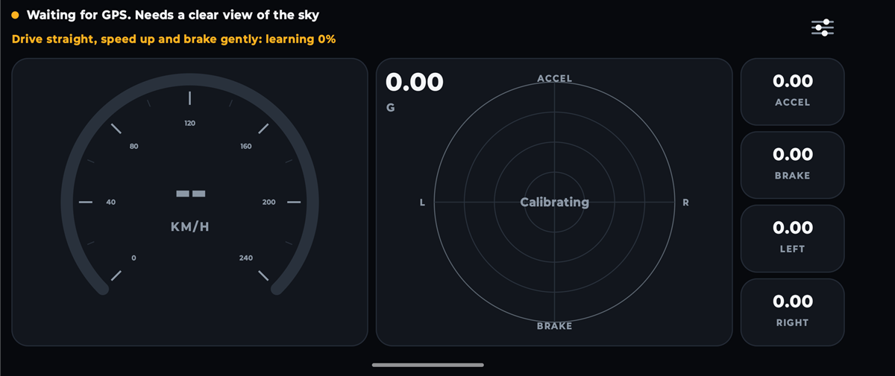

<div dir="rtl">

# SpeedG

[English](README.md) | **العربية**

تطبيق أندرويد يعرض سرعة سيارتك وقوة التسارع (G) باستخدام حساسات هاتفك، مع إمكانية قراءة السرعة من OBD-II أو Android Auto. لا يحتاج إلى حساب ولا يعرض إعلانات ولا يتطلب أجهزة إضافية.

<p align="center">
  
</p>
<p align="center">
  
</p>

*التُقطت الصور داخل مبنى والسيارة متوقفة، لذلك ما زال التطبيق ينتظر إشارة GPS ولا تظهر سرعة.*

> **حالة المشروع:** جرى تشغيل SpeedG على هاتف بنظام أندرويد 13، وقد اجتازت حساباته الاختبارات على رحلات محاكاة. لم يُختبر بعد في قيادة حقيقية، لذا لم تُقَس دقته على الطريق حتى الآن. كما لم يُختبر OBD-II وAndroid Auto مع سيارة أو محوّل حقيقي.

## المزايا

- **السرعة** بالكيلومتر أو الميل في الساعة، بدمج GPS مع مقياس التسارع لتقليل التأخير
- **اختيار مصدر السرعة:** GPS الهاتف أو محوّل OBD-II عبر البلوتوث أو Android Auto، مع التحول إلى GPS إذا توقف مصدر السيارة
- **حفظ السيارات:** تحتفظ كل سيارة بمصدر السرعة والمعايرة وأعلى القيم الخاصة بها
- **التعرف التلقائي على السيارة** برقم الهيكل (VIN) عبر OBD-II، أو بالشركة والطراز والسنة عبر Android Auto
- **مقياس G** يفصل بين التسارع والفرملة والانعطاف، ويعتمد دائمًا على حساسات الهاتف
- **أعلى القيم** لكل اتجاه، مع زر لإعادة الضبط
- **أي زاوية تثبيت:** يحدد التطبيق بنفسه اتجاه الأسفل والأمام
- **تصحيح المنحدرات** حتى لا يُحسب الميل تسارعًا
- **قراءات صادقة:** تُعلَّم السرعة كتقدير عند فقدان GPS، ثم تُخفى بعد ثوانٍ قليلة
- **أوضاع الشاشة:** تلقائي أو رأسي أو أفقي
- **تسجيل الرحلة** في ملف يمكنك مشاركته، بدون أي بيانات موقع
- **تنبيهات التحديث** عند صدور إصدار جديد

## التثبيت

1. نزّل أحدث ملف `SpeedG-*.apk` من صفحة [الإصدارات](https://github.com/alequab/SpeedG/releases/latest).
2. افتح الملف على هاتفك، واسمح بالتثبيت من هذا المصدر إذا طلب أندرويد ذلك.
3. اسمح بالموقع الدقيق عندما يطلبه SpeedG.

يحتاج SpeedG إلى أندرويد 8.0 أو أحدث، وهاتف فيه GPS ومقياس تسارع. ويُفضَّل وجود جيروسكوب.

## أول استخدام

1. ثبّت الهاتف جيدًا في حامل والسيارة متوقفة، واتركه ثابتًا بضع ثوانٍ.
2. انتظر في الخارج حتى تختفي رسالة GPS.
3. على طريق آمن ومستقيم، زد السرعة وخففها بلطف عدة مرات حتى تظهر عبارة **Calibrated**.

إذا حرّكت الهاتف داخل الحامل، فاضغط أيقونة الإعدادات ثم **Calibrate**.

### السرعة من سيارتك (اختياري)

اختر المصدر من **Speed source** في الإعدادات.

- **OBD-II:** تحتاج إلى محوّل ELM327 يعمل بالبلوتوث الكلاسيكي، فمحوّلات Bluetooth LE غير مدعومة. أقرنه من إعدادات أندرويد، ثم اختره في SpeedG.
- **Android Auto:** فعّل وضع المطوّر في Android Auto واسمح بخيار **Unknown sources**. أبقِ SpeedG مفتوحًا على شاشة السيارة وعلى هاتفك معًا. لا تشارك كل السيارات سرعتها.

لا يستطيع Android Auto التمييز بين سيارتين من الطراز والسنة نفسيهما. أما OBD-II فيستطيع ذلك إذا كانت السيارة تشارك رقم هيكلها.

**سلامتك أولًا:** جهّز التطبيق قبل القيادة، ودع أحد الركاب يتعامل مع الهاتف أثناء سير السيارة.

## طريقة العمل

| القراءة | الحساسات | الطريقة |
|---|---|---|
| السرعة | GPS ومقياس التسارع | يستخدم مرشح كالمان التسارع بين قراءات GPS، بينما يصحح GPS الانحراف |
| الأسفل والمنحدرات | مقياس التسارع والجيروسكوب | يتتبع الجيروسكوب الميل، وتصححه الحركة المحسوبة من GPS مع الوقت |
| اتجاه الأمام | GPS ومقياس التسارع | تُطابَق تغيرات السرعة على خط مستقيم مع القوة التي يشعر بها الهاتف |

## الخصوصية

- يُستخدم موقعك لقراءة سرعة GPS فقط، ولا يُحفظ ولا يُرسل إلى أي جهة.
- تحتوي تسجيلات الرحلات على قراءات الحساسات والسرعة بدون أي موقع أو رقم هيكل، وتبقى على هاتفك ما لم تشاركها.
- تبقى السيارات المحفوظة، بما فيها رقم الهيكل وعنوان محوّل البلوتوث، في مساحة التخزين الخاصة بالتطبيق على هاتفك.
- يُستخدم إذن البلوتوث للوصول إلى محوّل OBD-II فقط.
- عند كل تشغيل للتطبيق، يسأل خادم التحديث مرة واحدة عن رقم أحدث إصدار. لا يرسل هذا الطلب أي بيانات حساسات أو موقع، لكن يمكن للخادم رؤية عنوان IP الخاص بك كما في أي طلب عبر الإنترنت.

## البناء من المصدر

تحتاج إلى [Android Studio](https://developer.android.com/studio) أو Android SDK مع المنصة 37.

</div>

```bash
./gradlew :app:testDebugUnitTest
./gradlew :app:assembleDebug
```

<div dir="rtl">

يُحفظ ملف APK في المجلد `app/build/outputs/apk/debug/`. لا تتضمن النسخ المبنية من المصدر تنبيهات التحديث.

## الرخصة

يمكن **للأفراد** استخدام SpeedG وتعديله ومشاركته مجانًا للأغراض الشخصية. **ولا يحق للشركات والمؤسسات استخدامه** بدون إذن كتابي، ويشمل ذلك العاملين لحسابهم الخاص والأعمال الفردية عند استخدامه في عملهم. ولا يجوز بيعه. راجع ملف [LICENSE](LICENSE) للاطلاع على الشروط كاملة، والنص الإنجليزي هو المعتمد.

بسبب هذه القيود، يُعد SpeedG مشروعًا متاح الشيفرة للاطلاع (source-available) وليس مفتوح المصدر بالمعنى المعروف. وتبقى المكونات الخارجية المضمنة فيه خاضعة لرخصها الخاصة، وهي مذكورة في [THIRD_PARTY_NOTICES.md](THIRD_PARTY_NOTICES.md).

</div>
