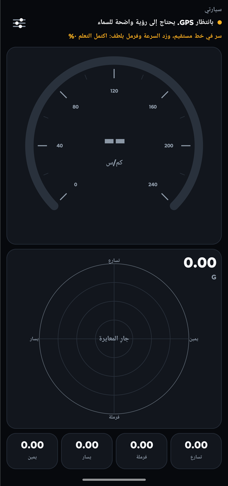
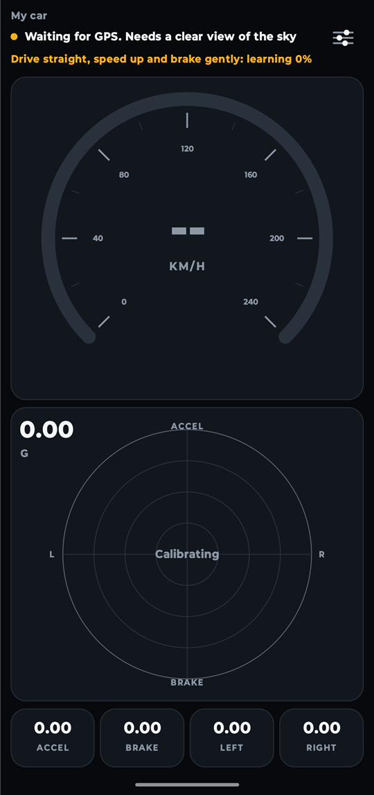
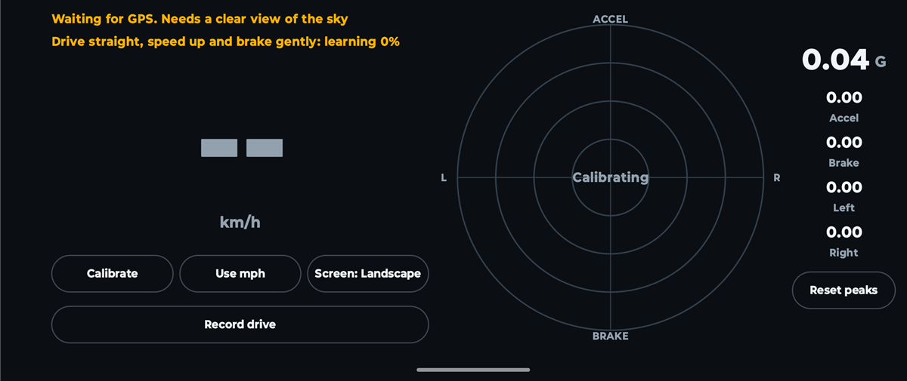

<div dir="rtl" align="center">

بسم الله الرحمن الرحيم

والصلاة والسلام على نبينا محمد

</div>

<div dir="rtl">

# زخم (SpeedG)

[العربية](#العربية) | [English](#english)

## العربية

**زخم** تطبيق أندرويد يعرض سرعة سيارتك وقوة التسارع (G) باستخدام حساسات هاتفك، مع إمكانية قراءة السرعة من OBD-II أو Android Auto. لا يحتاج إلى حساب ولا يعرض إعلانات ولا يتطلب أجهزة إضافية. ويتوفر التطبيق بالعربية والإنجليزية، واسمه بالإنجليزية Zakhm، ويُعرف أيضًا باسم SpeedG.

</div>

<p align="center">
  
  
</p>

<div dir="rtl">

*التُقطت الصور داخل مبنى والسيارة متوقفة، لذلك ما زال التطبيق ينتظر إشارة GPS ولا تظهر سرعة.*

> **حالة المشروع:** جرى تشغيل التطبيق على هاتف بنظام أندرويد 13، وقد اجتازت حساباته الاختبارات على رحلات محاكاة. لم يُختبر بعد في قيادة حقيقية، لذا لم تُقَس دقته على الطريق حتى الآن. كما لم يُختبر OBD-II وAndroid Auto مع سيارة أو محوّل حقيقي.

### المزايا

- **السرعة** بالكيلومتر أو الميل في الساعة، بدمج GPS مع مقياس التسارع لتقليل التأخير
- **اختيار مصدر السرعة:** GPS الهاتف أو محوّل OBD-II عبر البلوتوث أو Android Auto، مع التحول إلى GPS إذا توقف مصدر السيارة
- **حفظ السيارات:** تحتفظ كل سيارة بمصدر السرعة والمعايرة وأعلى القيم الخاصة بها
- **التعرف التلقائي على السيارة** برقم الهيكل (VIN) عبر OBD-II، أو بالشركة والطراز والسنة عبر Android Auto
- **مقياس G** يفصل بين التسارع والفرملة والانعطاف، ويعتمد دائمًا على حساسات الهاتف
- **أعلى القيم** لكل اتجاه، مع زر لإعادة الضبط
- **أي زاوية تثبيت:** يحدد التطبيق بنفسه اتجاه الأسفل والأمام
- **تصحيح المنحدرات** حتى لا يُحسب الميل تسارعًا
- **قراءات صادقة:** تُعلَّم السرعة كتقدير عند فقدان GPS، ثم تُخفى بعد ثوانٍ قليلة
- **العربية والإنجليزية** مع تخطيط من اليمين إلى اليسار، ويمكن اختيار اللغة من الإعدادات على أندرويد 13 أو أحدث
- **أوضاع الشاشة:** تلقائي أو رأسي أو أفقي
- **تسجيل الرحلة** في ملف يمكنك مشاركته، بدون أي بيانات موقع
- **تنبيهات التحديث** عند صدور إصدار جديد

### التثبيت

1. نزّل أحدث ملف `SpeedG-*.apk` من صفحة [الإصدارات](https://github.com/alequab/SpeedG/releases/latest).
2. افتح الملف على هاتفك، واسمح بالتثبيت من هذا المصدر إذا طلب أندرويد ذلك.
3. اسمح بالموقع الدقيق عندما يطلبه التطبيق.

يحتاج التطبيق إلى أندرويد 8.0 أو أحدث، وهاتف فيه GPS ومقياس تسارع. ويُفضَّل وجود جيروسكوب.

### أول استخدام

1. ثبّت الهاتف جيدًا في حامل والسيارة متوقفة، واتركه ثابتًا بضع ثوانٍ.
2. انتظر في الخارج حتى تختفي رسالة GPS.
3. على طريق آمن ومستقيم، زد السرعة وخففها بلطف عدة مرات حتى تختفي رسالة المعايرة.

إذا حرّكت الهاتف داخل الحامل، فاضغط أيقونة الإعدادات ثم **معايرة**.

**سلامتك أولًا:** جهّز التطبيق قبل القيادة، ودع أحد الركاب يتعامل مع الهاتف أثناء سير السيارة.

### السرعة من سيارتك (اختياري)

اختر المصدر من **مصدر السرعة** في الإعدادات.

- **OBD-II:** تحتاج إلى محوّل ELM327 يعمل بالبلوتوث. أقرن المحوّل الكلاسيكي من إعدادات أندرويد، أو ابحث عن محوّل Bluetooth LE من داخل التطبيق، ثم اختره.
- **Android Auto:** فعّل وضع المطوّر في Android Auto واسمح بخيار **Unknown sources**. أبقِ التطبيق مفتوحًا على شاشة السيارة وعلى هاتفك معًا. لا تشارك كل السيارات سرعتها.

لا يستطيع Android Auto التمييز بين سيارتين من الطراز والسنة نفسيهما. أما OBD-II فيستطيع ذلك إذا كانت السيارة تشارك رقم هيكلها.

### طريقة العمل

| القراءة | الحساسات | الطريقة |
|---|---|---|
| السرعة | GPS ومقياس التسارع | يستخدم مرشح كالمان التسارع بين قراءات GPS، بينما يصحح GPS الانحراف |
| الأسفل والمنحدرات | مقياس التسارع والجيروسكوب | يتتبع الجيروسكوب الميل، وتصححه الحركة المحسوبة من GPS مع الوقت |
| اتجاه الأمام | GPS ومقياس التسارع | تُطابَق تغيرات السرعة على خط مستقيم مع القوة التي يشعر بها الهاتف |

### الخصوصية

- يُستخدم موقعك لقراءة سرعة GPS فقط، ولا يُحفظ ولا يُرسل إلى أي جهة.
- تحتوي تسجيلات الرحلات على قراءات الحساسات والسرعة بدون أي موقع أو رقم هيكل، وتبقى على هاتفك ما لم تشاركها.
- تبقى السيارات المحفوظة، بما فيها رقم الهيكل وعنوان محوّل البلوتوث، في مساحة التخزين الخاصة بالتطبيق على هاتفك.
- يُستخدم إذن البلوتوث للعثور على محوّل OBD-II والوصول إليه فقط.
- عند كل تشغيل للتطبيق، يسأل خادم التحديث مرة واحدة عن رقم أحدث إصدار. لا يرسل هذا الطلب أي بيانات حساسات أو موقع، لكن يمكن للخادم رؤية عنوان IP الخاص بك كما في أي طلب عبر الإنترنت.

### البناء من المصدر

تحتاج إلى [Android Studio](https://developer.android.com/studio) أو Android SDK مع المنصة 37.

</div>

```bash
./gradlew :app:testDebugUnitTest
./gradlew :app:assembleDebug
```

<div dir="rtl">

يُحفظ ملف APK في المجلد `app/build/outputs/apk/debug/`. لا تتضمن النسخ المبنية من المصدر تنبيهات التحديث.

### الرخصة

يمكن **للأفراد** استخدام التطبيق وتعديله ومشاركته مجانًا للأغراض الشخصية. **ولا يحق للشركات والمؤسسات استخدامه** بدون إذن كتابي، ويشمل ذلك العاملين لحسابهم الخاص والأعمال الفردية عند استخدامه في عملهم. ولا يجوز بيعه. راجع ملف [LICENSE](LICENSE) للاطلاع على الشروط كاملة، والنص الإنجليزي هو المعتمد.

بسبب هذه القيود، يُعد المشروع متاح الشيفرة للاطلاع (source-available) وليس مفتوح المصدر بالمعنى المعروف. وتبقى المكونات الخارجية المضمنة فيه خاضعة لرخصها الخاصة، وهي مذكورة في [THIRD_PARTY_NOTICES.md](THIRD_PARTY_NOTICES.md).

</div>

---

## English

**Zakhm** (زخم, meaning "momentum"), also known as SpeedG, is an Android app that shows your car's speed and G-force using your phone's sensors, with optional speed from OBD-II or Android Auto. No account, no ads and no extra hardware required. The app is available in Arabic and English.

<p align="center">
  
</p>
<p align="center">
  
</p>

*Screenshots were taken indoors while parked, so the app is still waiting for a GPS signal and no speed is shown.*

> **Project status:** Zakhm has run on an Android 13 phone, and its calculations pass tests on simulated drives. It has not been checked on a real drive yet, so its road accuracy is still unmeasured. OBD-II and Android Auto have not been tested with a real car or adapter.

### Features

- **Speed** in km/h or mph, combining GPS with the accelerometer to reduce lag
- **Choice of speed source**: phone GPS, a Bluetooth OBD-II adapter or Android Auto, switching to GPS if a car source stops
- **Saved cars** that each keep their own speed source, calibration and peak values
- **Automatic car recognition** by VIN over OBD-II, or by make, model and year over Android Auto
- **G-force meter** that separates acceleration, braking and cornering, always using the phone's sensors
- **Peak values** for each direction, with a reset button
- **Any mounting angle**: the app works out which way is down and forward
- **Hill correction**, so a slope doesn't read as acceleration
- **Honest readings**: speed is marked as an estimate when GPS is lost, then hidden after a few seconds
- **Arabic and English** with a right-to-left layout, and a language choice in settings on Android 13 or newer
- **Screen modes**: Auto, Portrait or Landscape
- **Drive recording** to a file you can share, containing no location
- **Update alerts** when a new version is released

### Install

1. Download the latest `SpeedG-*.apk` from [Releases](https://github.com/alequab/SpeedG/releases/latest).
2. Open the file on your phone and allow installs from that source if Android asks.
3. Allow precise location when the app asks.

Zakhm needs Android 8.0 or newer and a phone with GPS and an accelerometer. A gyroscope is recommended.

### First use

1. Fix the phone firmly in a mount while the car is parked, and keep it still for a few seconds.
2. Wait outside until the GPS message clears.
3. On a safe, straight road, speed up and slow down gently a few times until the calibration message clears.

If you move the phone in its mount, tap the settings icon, then **Calibrate**.

**Stay safe:** set the app up before driving, and let a passenger handle the phone while the car is moving.

### Speed from your car (optional)

Choose the source under **Speed source** in settings.

- **OBD-II:** you need a Bluetooth ELM327 adapter. Pair a classic adapter in Android's settings, or scan for a Bluetooth LE adapter in the app, then choose it.
- **Android Auto:** turn on Android Auto's developer mode and allow **Unknown sources**. Keep the app open on both the car screen and your phone. Not every car shares its speed.

Android Auto can't tell two cars of the same model and year apart. OBD-II can, if the car shares its VIN.

### How it works

| Reading | Sensors | Method |
|---|---|---|
| Speed | GPS and accelerometer | A Kalman filter uses acceleration between GPS fixes, while GPS corrects the drift |
| Down and hills | Accelerometer and gyroscope | The gyroscope tracks tilt, and GPS-derived motion corrects it over time |
| Forward direction | GPS and accelerometer | Straight-line speed changes are matched with the force the phone feels |

### Privacy

- Your location is used only to read GPS speed. It is never saved or sent anywhere.
- Drive recordings contain sensor readings and speed, but no position or VIN. They stay on your phone unless you share them.
- Saved cars, including any VIN or Bluetooth adapter address, stay in the app's private storage on your phone.
- Bluetooth permission is only used to find and reach your OBD-II adapter.
- Once each time the app starts, it asks an update server for the newest version number. That request sends no sensor or location data, though the server can see your IP address, as with any internet request.

### Build from source

You need [Android Studio](https://developer.android.com/studio) or the Android SDK with platform 37.

```bash
./gradlew :app:testDebugUnitTest
./gradlew :app:assembleDebug
```

The APK is written to `app/build/outputs/apk/debug/`. Builds from source don't include update alerts.

### License

Zakhm is free for **individuals** to use, modify and share for personal purposes. **Companies and organizations may not use it** without written permission, including freelancers and one-person businesses using it for their work. It may not be sold. See [LICENSE](LICENSE) for the full terms.

Because of these limits, Zakhm is source-available rather than open source. The third-party components it includes keep their own licenses, listed in [THIRD_PARTY_NOTICES.md](THIRD_PARTY_NOTICES.md).
