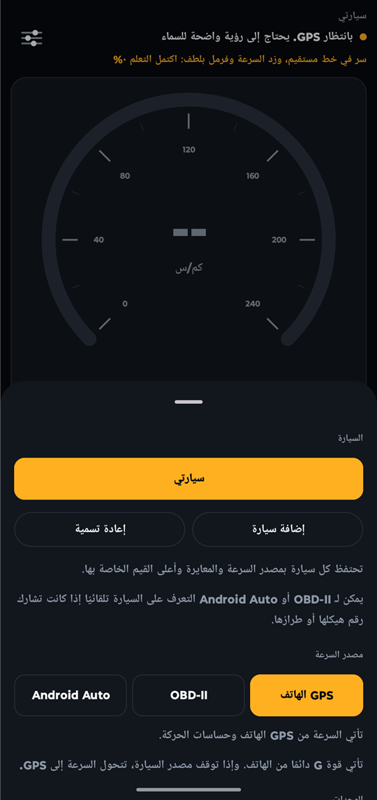
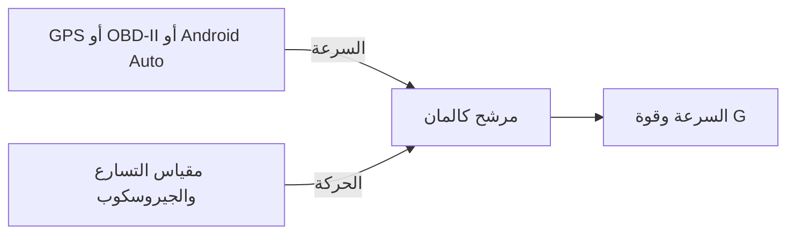
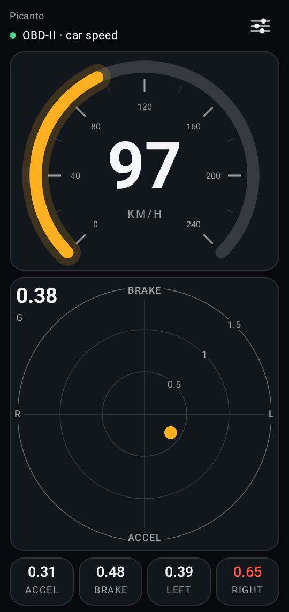
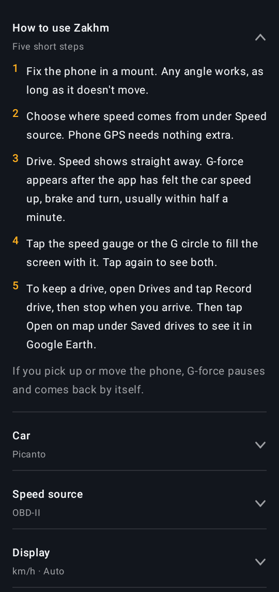
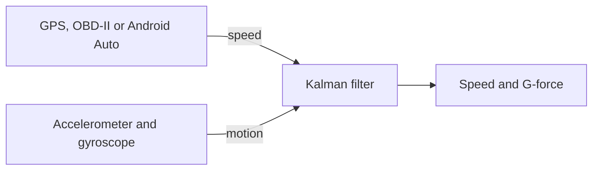

<div dir="rtl" align="center">

<picture>
  <source media="(prefers-color-scheme: dark)" srcset="docs/opening-dark.png">
  <source media="(prefers-color-scheme: light)" srcset="docs/opening-light.png">
  
</picture>

<br>

<h2>زخم · Zakhm</h2>

**سرعة سيارتك وقوة التسارع على هاتفك، بدون أي أجهزة إضافية.**

*Your car's speed and G-force on your phone, with no extra hardware.*

<br>


[](LICENSE)

<br>

### [العربية](#العربية) &nbsp;·&nbsp; [English](#english)

</div>

---

<div dir="rtl" lang="ar">

## العربية

**زخم** تطبيق أندرويد يعرض سرعة سيارتك وقوة التسارع (G) باستخدام حساسات هاتفك. ويمكنه أيضًا قراءة السرعة من السيارة عبر محوّل OBD-II أو Android Auto. لا يحتاج إلى حساب ولا يعرض إعلانات.

<table>
<tr>
<td width="50%"><p align="center"><b>لوحة العدادات</b></p></td>
<td width="50%"><p align="center"><b>الإعدادات</b></p></td>
</tr>
</table>

<p align="center"><i>التُقطت الصور داخل مبنى والسيارة متوقفة، لذلك ما زال التطبيق ينتظر إشارة GPS ولا تظهر سرعة.</i></p>

### المزايا

<table>
<tr>
<td width="50%" valign="top"><b>السرعة</b><br>بالكيلومتر أو الميل في الساعة، بدمج GPS مع مقياس التسارع لتقليل التأخير.</td>
<td width="50%" valign="top"><b>مقياس G</b><br>يفصل بين التسارع والفرملة والانعطاف، مع أعلى القيم لكل اتجاه.</td>
</tr>
<tr>
<td valign="top"><b>مصدر السرعة</b><br>GPS الهاتف أو محوّل OBD-II أو Android Auto، مع التحول إلى GPS إذا توقف مصدر السيارة.</td>
<td valign="top"><b>حفظ السيارات</b><br>تحتفظ كل سيارة بمصدر السرعة والمعايرة وأعلى القيم الخاصة بها.</td>
</tr>
<tr>
<td valign="top"><b>التعرف على السيارة</b><br>برقم الهيكل (VIN) عبر OBD-II، أو بالطراز عبر Android Auto. تُحمَّل السيارة المعروفة تلقائيًا، ويسألك التطبيق قبل حفظ سيارة جديدة.</td>
<td valign="top"><b>أي زاوية تثبيت</b><br>يحدد التطبيق بنفسه اتجاه الأسفل والأمام، ويصحح أثر المنحدرات.</td>
</tr>
<tr>
<td valign="top"><b>العربية والإنجليزية</b><br>تخطيط من اليمين إلى اليسار، مع اختيار اللغة من الإعدادات على أندرويد 13 أو أحدث.</td>
<td valign="top"><b>قراءات صادقة</b><br>تُعلَّم السرعة كتقدير عند فقدان GPS، ثم تُخفى بعد ثوانٍ قليلة.</td>
</tr>
<tr>
<td valign="top"><b>تسجيل الرحلة</b><br>يحفظ قراءات الحساسات في ملف يمكنك مشاركته، بدون أي بيانات موقع.</td>
<td valign="top"><b>تحديث من داخل التطبيق</b><br>إشعار عند صدور إصدار جديد، وتنزيل موثَّق بضغطة، ويبقى التثبيت بموافقتك.</td>
</tr>
<tr>
<td valign="top"><b>مظهر لكل سيارة</b><br>ثمانية ألوان جاهزة أو ألوانك الخاصة، ويتغيّر المظهر مع تغيّر السيارة وتبقى الأرقام واضحة.</td>
<td valign="top"><b>ملاحظة تحريك الهاتف</b><br>إذا تحرّك الهاتف أثناء القيادة، يلاحظ التطبيق ذلك ويعيد المعايرة بدل عرض قراءات خاطئة.</td>
</tr>
</table>

### البدء السريع

**المتطلبات:** هاتف بنظام أندرويد 8.0 أو أحدث فيه GPS ومقياس تسارع، ويُفضَّل وجود جيروسكوب.

1. نزّل أحدث ملف `Zakhm-*.apk` من صفحة [الإصدارات](https://github.com/alequab/Zakhm/releases/latest).
2. افتح الملف على هاتفك، واسمح بالتثبيت من هذا المصدر إذا طلب أندرويد ذلك.
3. اسمح بالموقع الدقيق عندما يطلبه التطبيق.

**أول استخدام:**

1. ثبّت الهاتف جيدًا في حامل والسيارة متوقفة، واتركه ثابتًا بضع ثوانٍ.
2. انتظر في الخارج حتى تختفي رسالة GPS.
3. قُد بشكل طبيعي، فتختفي رسالة المعايرة بعد تغييرات قليلة في السرعة أو بعض المنعطفات.

إذا حرّكت الهاتف داخل الحامل، فسيعيد التطبيق المعايرة غالبًا من تلقاء نفسه. ويمكنك أيضًا الضغط على أيقونة الإعدادات ثم **معايرة**.

لتغيير الألوان، افتح الإعدادات ثم **المظهر**.

### كيف يعمل

<div dir="ltr">



</div>

### السلامة والخصوصية

- **لا تستخدم التطبيق أثناء القيادة.** جهّزه قبل الانطلاق، ودع أحد الركاب يتعامل مع الهاتف أثناء سير السيارة.
- **ثبّت الهاتف في حامل متين.** فالحامل المهتز يضيف أخطاء لا يزيلها التطبيق بالكامل.
- **موقعك لا يخرج من هاتفك.** يُستخدم لقراءة سرعة GPS فقط، ولا يُحفظ ولا يُرسل إلى أي جهة.
- **بياناتك على هاتفك.** تبقى السيارات المحفوظة، بما فيها رقم الهيكل وعنوان محوّل البلوتوث، في مساحة التخزين الخاصة بالتطبيق. ولا تحتوي تسجيلات الرحلات على موقع أو رقم هيكل، وتبقى على هاتفك ما لم تشاركها.
- **الإنترنت للتحديثات فقط.** عند كل تشغيل وكل 12 ساعة في الخلفية، يسأل التطبيق خادم التحديث عن أحدث إصدار، ولا يُنزّل التحديث إلا إذا ضغطت تحديث. لا ترسل هذه الطلبات أي بيانات حساسات أو موقع، لكن يمكن للخادم رؤية عنوان IP الخاص بك كما في أي طلب عبر الإنترنت.

### ما يجب معرفته

- جرى تشغيل التطبيق على هاتف بنظام أندرويد 13 وفي رحلات حقيقية قليلة، واجتازت حساباته الاختبارات على رحلات محاكاة. لكن لم تُقارَن دقته بعد بجهاز قياس مرجعي.
- في رحلة قصيرة، قرأ التطبيق السرعة ورقم الهيكل من سيارة حقيقية عبر محوّل OBD-II يعمل بتقنية Bluetooth LE. ولم تُجرَّب المحوّلات الكلاسيكية ولا Android Auto مع جهاز أو سيارة حقيقية.
- في رحلة حقيقية مدتها نحو 80 دقيقة، لاحظ التطبيق تحريك الهاتف في المرات التي فُحصت، وكانت قوة G الأمامية قريبة مما تدل عليه تغيرات سرعة GPS.
- قد يعرض GPS سرعة صغيرة والسيارة واقفة، فتظهر تلك السرعة لبضع ثوانٍ قبل أن يلاحظ التطبيق التوقف.
- لا يستطيع Android Auto التمييز بين سيارتين من الطراز والسنة نفسيهما. أما OBD-II فيستطيع ذلك إذا كانت السيارة تشارك رقم هيكلها.

<details>
<summary><b>السرعة من سيارتك</b></summary>

<br>

اختر المصدر من **مصدر السرعة** في الإعدادات.

- **OBD-II:** تحتاج إلى محوّل ELM327 يعمل بالبلوتوث. أقرن المحوّل الكلاسيكي من إعدادات أندرويد، أو ابحث عن محوّل Bluetooth LE من داخل التطبيق، ثم اختره.
- **Android Auto:** فعّل وضع المطوّر في Android Auto واسمح بخيار **Unknown sources**. أبقِ التطبيق مفتوحًا على شاشة السيارة وعلى هاتفك معًا. لا تشارك كل السيارات سرعتها.

تأتي قوة G دائمًا من حساسات الهاتف، أيًّا كان مصدر السرعة.

</details>

<details>
<summary><b>التطوير وملفات المشروع</b></summary>

<br>

تحتاج إلى [Android Studio](https://developer.android.com/studio) أو Android SDK مع المنصة 37. شغّل الاختبارات وابنِ التطبيق:

<div dir="ltr">

```
./gradlew :app:testDebugUnitTest
./gradlew :app:assembleDebug
```

</div>

يُحفظ ملف APK في المجلد `app/build/outputs/apk/debug/`. لا تتضمن النسخ المبنية من المصدر تنبيهات التحديث.

| الملف | وظيفته |
|---|---|
| `core/TelemetryEngine.kt` | حساب السرعة وقوة G والمعايرة |
| `core/SpeedFilter.kt` | مرشح كالمان للسرعة |
| `core/ForwardLearner.kt` | تحديد اتجاه الأمام |
| `core/CarProfiles.kt` | السيارات المحفوظة والتعرف عليها |
| `core/CarTheme.kt` | ألوان المظهر والحفاظ على وضوحها |
| `core/Obd.kt` | بروتوكول OBD-II ورقم الهيكل |
| `ObdLinks.kt` | الاتصال بالمحوّل بالبلوتوث الكلاسيكي وBluetooth LE |
| `car/SpeedCarAppService.kt` | شاشة Android Auto |
| `TelemetryScreen.kt` | شاشات التطبيق |
| `app/src/test/` | الاختبارات |

</details>

### الرخصة

يمكن **للأفراد** استخدام زخم وتعديله ومشاركته مجانًا للأغراض الشخصية. **ولا يحق للشركات والمؤسسات استخدامه** بدون إذن كتابي، ويشمل ذلك العاملين لحسابهم الخاص والأعمال الفردية عند استخدامه في عملهم. ولا يجوز بيعه. راجع ملف [LICENSE](LICENSE) للاطلاع على الشروط كاملة، والنص الإنجليزي هو المعتمد.

بسبب هذه القيود، يُعد زخم مشروعًا متاح الشيفرة للاطلاع (source-available) وليس مفتوح المصدر بالمعنى المعروف. وتبقى المكونات الخارجية المضمنة فيه خاضعة لرخصها الخاصة، وهي مذكورة في [THIRD_PARTY_NOTICES.md](THIRD_PARTY_NOTICES.md).

</div>

---

## English

**Zakhm** (زخم, meaning "momentum") is an Android app that shows your car's speed and G-force using your phone's sensors. It can also read speed from the car through an OBD-II adapter or Android Auto. No account and no ads.

<table>
<tr>
<td width="50%"><p align="center"><b>Dashboard</b></p></td>
<td width="50%"><p align="center"><b>Settings</b></p></td>
</tr>
</table>

<p align="center"><i>Screenshots were taken indoors while parked, so the app is still waiting for a GPS signal and no speed is shown.</i></p>

### Features

<table>
<tr>
<td width="50%" valign="top"><b>Speed</b><br>In km/h or mph, combining GPS with the accelerometer to reduce lag.</td>
<td width="50%" valign="top"><b>G-force meter</b><br>Separates acceleration, braking and cornering, with peak values for each direction.</td>
</tr>
<tr>
<td valign="top"><b>Speed source</b><br>Phone GPS, an OBD-II adapter or Android Auto, switching to GPS if a car source stops.</td>
<td valign="top"><b>Saved cars</b><br>Each car keeps its own speed source, calibration and peak values.</td>
</tr>
<tr>
<td valign="top"><b>Car recognition</b><br>By VIN over OBD-II, or by model over Android Auto. A known car loads automatically, and the app asks before saving a new one.</td>
<td valign="top"><b>Any mounting angle</b><br>The app works out which way is down and forward, and corrects for hills.</td>
</tr>
<tr>
<td valign="top"><b>Arabic and English</b><br>Right-to-left layout, with a language choice in settings on Android 13 or newer.</td>
<td valign="top"><b>Honest readings</b><br>Speed is marked as an estimate when GPS is lost, then hidden after a few seconds.</td>
</tr>
<tr>
<td valign="top"><b>Drive recording</b><br>Saves sensor readings to a file you can share, with no location data.</td>
<td valign="top"><b>In-app updates</b><br>A notification when a new version is out, a verified one-tap download, and you approve the install.</td>
</tr>
<tr>
<td valign="top"><b>A theme for each car</b><br>Eight ready-made colours or your own. The theme switches with the car, and the numbers stay clear.</td>
<td valign="top"><b>Notices a moved phone</b><br>If the phone moves during a drive, the app notices and calibrates again instead of showing wrong readings.</td>
</tr>
</table>

### Quick start

**You need:** a phone with Android 8.0 or newer, GPS and an accelerometer. A gyroscope is recommended.

1. Download the latest `Zakhm-*.apk` from [Releases](https://github.com/alequab/Zakhm/releases/latest).
2. Open the file on your phone and allow installs from that source if Android asks.
3. Allow precise location when the app asks.

**First use:**

1. Fix the phone firmly in a mount while the car is parked, and keep it still for a few seconds.
2. Wait outside until the GPS message clears.
3. Drive normally. The calibration message clears after a few speed changes or turns.

If you move the phone in its mount, the app will usually calibrate again by itself. You can also tap the settings icon, then **Calibrate**.

To change the colours, open settings, then **Theme**.

### How it works



### Safety and privacy

- **Don't use the app while driving.** Set it up before you leave, and let a passenger handle the phone while the car is moving.
- **Use a firm mount.** A shaky mount adds errors the app can't fully remove.
- **Your location stays on your phone.** It's used only to read GPS speed, and it's never saved or sent anywhere.
- **Your data stays on your phone.** Saved cars, including any VIN or Bluetooth adapter address, stay in the app's private storage. Drive recordings contain no position or VIN, and stay on your phone unless you share them.
- **Internet for updates only.** Each time it starts and every 12 hours in the background, the app asks an update server for the newest version, and only downloads it if you tap Update. These requests send no sensor or location data, though the server can see your IP address, as with any internet request.

### Good to know

- The app has run on an Android 13 phone and on a few real drives, and its calculations pass tests on simulated drives. Its accuracy hasn't been compared with a reference instrument yet.
- On a short drive, the app read speed and the VIN from a real car through a Bluetooth LE OBD-II adapter. Classic adapters and Android Auto haven't been tried with a real device or car.
- On a real drive of about 80 minutes, the app noticed the moved phone in the cases checked, and forward G closely followed what GPS speed changes showed.
- GPS can report a small speed while the car is standing still, and that speed may show for a few seconds before the app notices the stop.
- Android Auto can't tell two cars of the same model and year apart. OBD-II can, if the car shares its VIN.

<details>
<summary><b>Speed from your car</b></summary>

<br>

Choose the source under **Speed source** in settings.

- **OBD-II:** you need a Bluetooth ELM327 adapter. Pair a classic adapter in Android's settings, or scan for a Bluetooth LE adapter in the app, then choose it.
- **Android Auto:** turn on Android Auto's developer mode and allow **Unknown sources**. Keep the app open on both the car screen and your phone. Not every car shares its speed.

G-force always comes from the phone's sensors, whichever speed source you use.

</details>

<details>
<summary><b>Development and project files</b></summary>

<br>

You need [Android Studio](https://developer.android.com/studio) or the Android SDK with platform 37. Run the tests and build the app:

```
./gradlew :app:testDebugUnitTest
./gradlew :app:assembleDebug
```

The APK is written to `app/build/outputs/apk/debug/`. Builds from source don't include update alerts.

| File | Purpose |
|---|---|
| `core/TelemetryEngine.kt` | Speed, G-force and calibration calculations |
| `core/SpeedFilter.kt` | Kalman filter for speed |
| `core/ForwardLearner.kt` | Works out which way is forward |
| `core/CarProfiles.kt` | Saved cars and recognizing them |
| `core/CarTheme.kt` | Theme colours and keeping them readable |
| `core/Obd.kt` | OBD-II protocol and VIN reading |
| `ObdLinks.kt` | Classic Bluetooth and Bluetooth LE adapter connections |
| `car/SpeedCarAppService.kt` | Android Auto screen |
| `TelemetryScreen.kt` | The app's screens |
| `app/src/test/` | Tests |

</details>

### License

Zakhm is free for **individuals** to use, modify and share for personal purposes. **Companies and organizations may not use it** without written permission, including freelancers and one-person businesses using it for their work. It may not be sold. See [LICENSE](LICENSE) for the full terms.

Because of these limits, Zakhm is source-available rather than open source. The third-party components it includes keep their own licenses, listed in [THIRD_PARTY_NOTICES.md](THIRD_PARTY_NOTICES.md).
